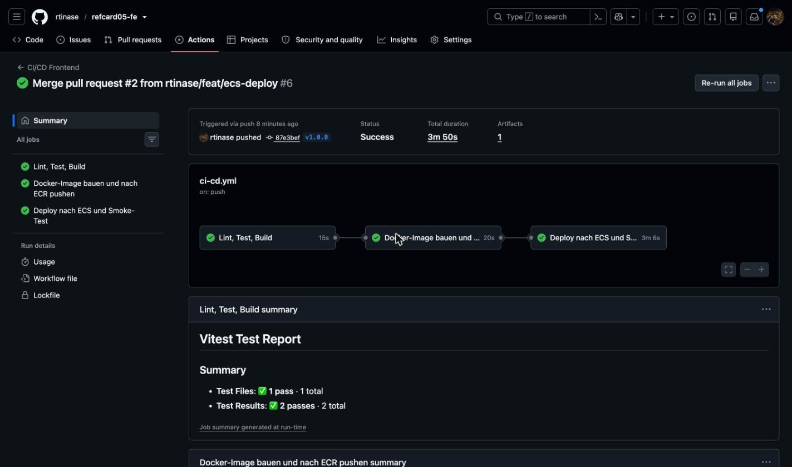
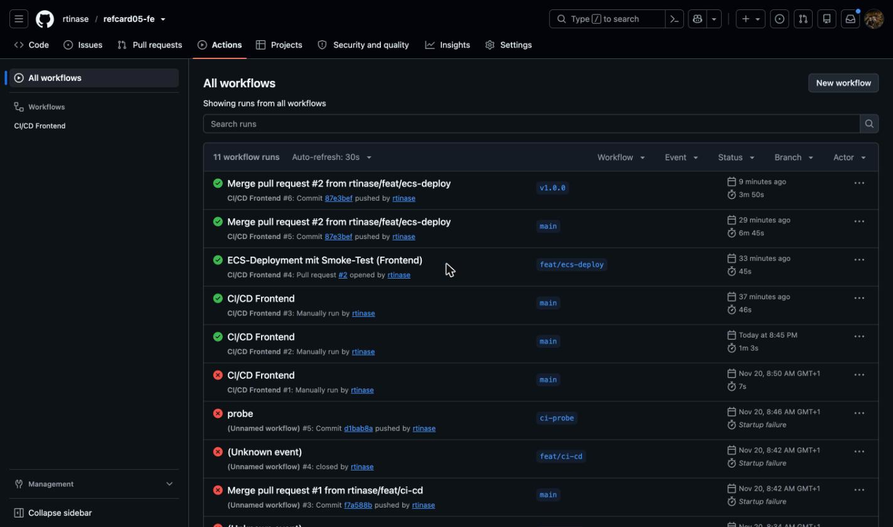
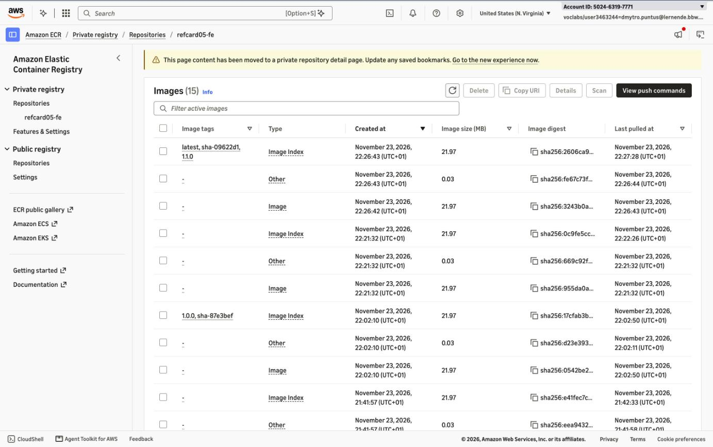
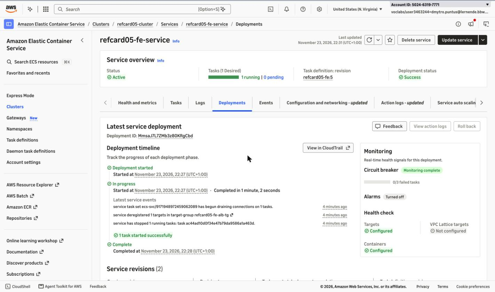
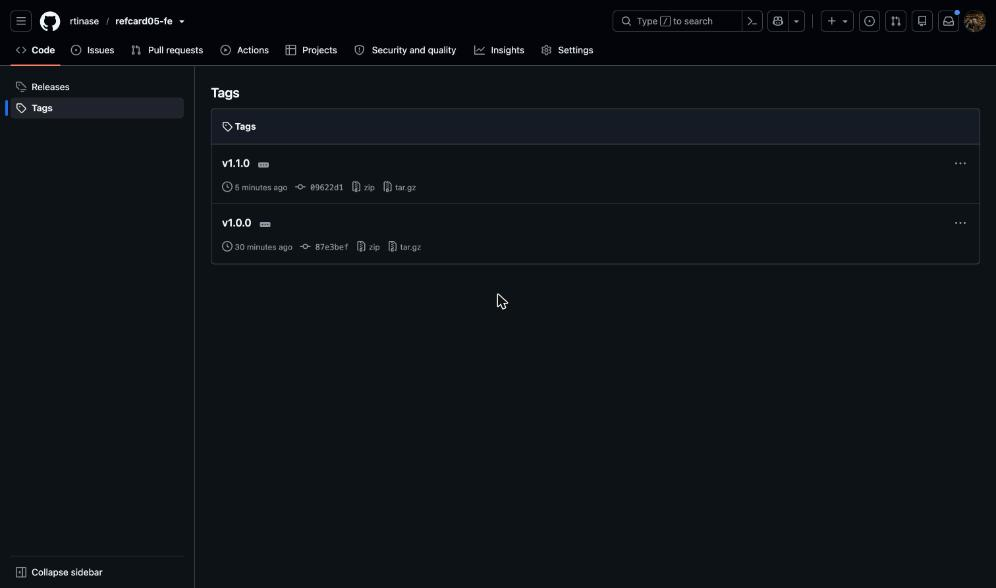
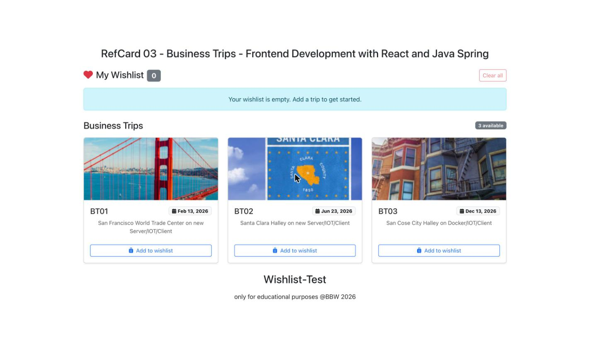

# RefCard05 – Frontend: Ergebnis

Das Frontend (React + Vite) läuft als **nginx-Container auf Amazon ECS (Fargate)** hinter einem eigenen Load Balancer.
Die vollständige Dokumentation (Architektur, Backend, RDS, S3, Learner-Lab-Zugangsdaten, OIDC-Vergleich, Docker Compose,
Probleme und Lösungen) steht im Backend-Repo:
**[RefCard05-Ergebnis.md im Backend-Repo](https://github.com/rtinase/refcard05-be/blob/main/docs/RefCard05-Ergebnis.md)**.

- Backend-Repo (inkl. Docker Compose für die lokale Entwicklung): https://github.com/rtinase/refcard05-be
- Live (solange das Learner Lab läuft): http://refcard05-fe-alb-400588137.us-east-1.elb.amazonaws.com

## Was in diesem Repo liegt

| Datei | Zweck |
|---|---|
| `.github/workflows/ci-cd.yml` | Pipeline: Lint, Test, Build → Docker-Image → ECR → ECS → Smoke-Test |
| `Dockerfile` | Multi-Stage: Node baut das Vite-Projekt, das fertige Image enthält nur nginx und die statischen Dateien |
| `nginx.conf`, `security-headers.conf` | SPA-Fallback, Caching der Assets, `/healthz`, Security-Header |
| `task-definition.json` | ECS-Task-Definition (Vorlage; Account-ID und Region setzt die Pipeline ein) |

## Pipeline

1. **Lint, Test, Build:** `npm ci`, ESLint, Vitest, `vite build` (npm-Cache).
2. **Image:** Docker Buildx mit GitHub-Actions-Cache. Push nach ECR nur von `main` und Release-Tags.
3. **Deploy:** Task-Definition rendern, ECS-Service aktualisieren, auf Stabilität warten, danach Smoke-Test (`/healthz` und App-Seite).

Die Backend-URL (`VITE_API_BASE_URL`) bettet Vite beim Build ein. Die Pipeline setzt sie als Build-Argument aus der GitHub-Variable
`VITE_API_BASE_URL`; sie zeigt auf den Backend-Load-Balancer.

## Versionierung

Ein Tag `vMAJOR.MINOR.PATCH` bestimmt den Image-Tag in ECR (`v1.1.0` → `1.1.0`); jeder Build bekommt zusätzlich `sha-<Commit>`,
`main` zusätzlich `latest`. Deployt wird immer der `sha-…`-Tag. Dasselbe Schema gilt im Backend-Repo.

| Release | Frontend | Änderung |
|---|---|---|
| `v1.0.0` | `87e3bef` | erster vollständiger Stand auf AWS |
| `v1.1.0` | `09622d1` | nginx-Security-Header, dadurch automatisches Redeploy |

## Nachweise

## Lokal starten

Frontend, Backend und Datenbank zusammen: siehe [`docker-compose-local/`](https://github.com/rtinase/refcard05-be/tree/main/docker-compose-local) im Backend-Repo.
Nur das Frontend: `npm ci && npm run dev` (nutzt `VITE_API_BASE_URL` aus `.env`, Standard `http://localhost:8080/`).
